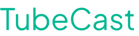

<p align="center">
  
</p>

<p align="center">
  <strong>Turn YouTube into a podcast.</strong><br>
  Channels, playlists, and videos — as RSS feeds in your favorite podcast app.
</p>

<p align="center">
  <a href="#quick-start">Quick Start</a> · <a href="#features">Features</a> · <a href="#api">API</a> · <a href="#configuration">Configuration</a>
</p>

---

## How It Works

1. **Paste** a YouTube URL — channel, playlist, or single video
2. **TubeCast** fetches metadata and generates a podcast-compatible RSS feed
3. **Subscribe** in any podcast app (Apple Podcasts, Overcast, Pocket Casts, etc.)
4. **Listen** — the 5 most recent episodes are auto-downloaded and ready instantly

```
YouTube URL → TubeCast → RSS Feed → Your Podcast App
                  ↓                       ↓
           Auto-download top 5      Instant playback
```

## Features

- **Channels, Playlists & Single Videos** — supports any YouTube URL format including `@handles`, `/channel/`, `/c/`, `/user/`, and `youtu.be` short links
- **Proactive Downloads** — the 5 most recent episodes per subscription are automatically downloaded; older cached audio is evicted to save disk space
- **On-Demand Fallback** — older episodes are still available; audio is extracted and converted to MP3 via yt-dlp + ffmpeg when requested
- **Automatic Polling** — new episodes discovered on a configurable schedule
- **Episode Filters** — filter out livestreams, shorts, or set min/max duration thresholds per subscription
- **iTunes-Compatible RSS** — proper `<itunes:*>` tags, artwork, and durations so feeds look great in any podcast app
- **Web Dashboard** — create feeds, manage subscriptions, and browse episodes
- **REST API** — full CRUD at `/api/subscriptions`
- **SQLite Storage** — lightweight, zero-config database with WAL mode and automatic migrations
- **Docker Ready** — single container with everything included

## Quick Start

### Docker (recommended)

```bash
docker compose up --build
```

Open **http://localhost:5151** and paste a YouTube URL.

### Without Docker

Requires [Node.js](https://nodejs.org/) 20+, [ffmpeg](https://ffmpeg.org/), and [yt-dlp](https://github.com/yt-dlp/yt-dlp).

```bash
# Install system dependencies (macOS)
brew install ffmpeg yt-dlp

# Install Node dependencies
npm install

# Build and run
npm run build
npm start

# Or run in development mode (no build step)
npm run dev
```

Open **http://localhost:3000**.

## Configuration

All configuration is via environment variables:

| Variable | Default | Description |
|----------|---------|-------------|
| `PORT` | `3000` | Server port |
| `DATA_DIR` | `./data` | Directory for SQLite database |
| `FEED_BASE_URL` | `http://localhost:$PORT` | Public URL for RSS feed links (set to your domain in production) |
| `POLL_INTERVAL_MINUTES` | `15` | How often to check for new episodes |
| `INITIAL_EPISODES` | `10` | Episodes to fetch on first subscription |
| `AUDIO_CACHE_TTL_HOURS` | `24` | Cached MP3 files older than this are cleaned up |

## API

### Subscriptions

| Method | Endpoint | Description |
|--------|----------|-------------|
| `POST` | `/api/subscriptions` | Create subscription (`{ "url": "..." }`) |
| `GET` | `/api/subscriptions` | List all subscriptions |
| `GET` | `/api/subscriptions/:id` | Get subscription with episodes |
| `PATCH` | `/api/subscriptions/:id/filters` | Update filters |
| `DELETE` | `/api/subscriptions/:id` | Delete subscription |

### Feeds & Audio

| Method | Endpoint | Description |
|--------|----------|-------------|
| `GET` | `/feed/:id.xml` | RSS feed for a subscription |
| `GET` | `/audio/:videoId.mp3` | Stream audio for a video |
| `GET` | `/audio/progress/:videoId` | Download progress |
| `GET` | `/audio/cache/info` | Cache stats (file count, total size) |
| `DELETE` | `/audio/cache` | Clear entire audio cache |
| `DELETE` | `/audio/cache/:videoId` | Clear cache for a single video |

## Project Structure

```
TubeCast/
├── src/
│   ├── index.ts              # Express app entry point
│   ├── config.ts             # Environment configuration
│   ├── types.ts              # Shared TypeScript interfaces
│   ├── api/
│   │   ├── views.ts          # Web UI routes
│   │   ├── subscriptions.ts  # REST API
│   │   ├── feed.ts           # RSS feed endpoint
│   │   └── audio.ts          # Audio streaming, caching & download
│   ├── db/
│   │   ├── index.ts          # Database access layer
│   │   └── schema.ts         # Versioned migrations
│   ├── rss/
│   │   └── index.ts          # RSS XML generation
│   ├── scheduler/
│   │   └── index.ts          # Cron polling + proactive downloads
│   ├── youtube/
│   │   └── index.ts          # yt-dlp wrapper & URL parsing
│   └── views/                # EJS templates
├── public/                   # Static assets
├── Dockerfile
└── docker-compose.yml
```

## Disclaimer

This project has been 100% vibe coded. It was built as a fun personal project to scratch my own itch. It comes with absolutely no warranty or guarantees. Use it at your own risk — I'm not responsible for any issues it may cause.

## Contributing

See [CONTRIBUTING.md](CONTRIBUTING.md) for guidelines.

## Security

To report a vulnerability, see [SECURITY.md](SECURITY.md).

## License

[ISC](LICENSE)
